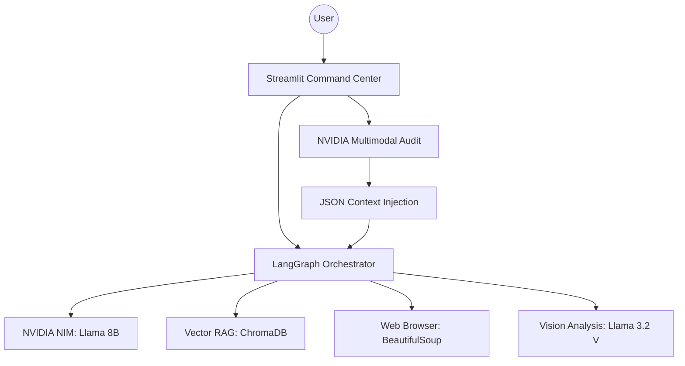

# 🛡️ ENSIA Export AI Engine
### High-Precision Agentic RAG for Export Compliance (2026 Edition)

The **ENSIA Export AI Engine** is a state-of-the-art compliance assistant designed to automate the auditing, research, and documentation of export-grade products. Built for the ENSIA 3rd Year Group Project, it leverages a sophisticated **Agentic RAG** architecture powered exclusively by the **NVIDIA NIM** ecosystem.

---

## 🚀 Key Features

### 1. 🧠 Autonomous Agentic Orchestrator
- **Engine**: Powered by **LangGraph** (2026 Standard) for robust ReAct (Reasoning + Acting) loops.
- **LLM**: Utilizes **Meta Llama 3.1 8B Instruct** (via NVIDIA NIM) for ultra-fast, low-latency reasoning.
- **Tools**: The agent autonomously uses RAG, Web Browsing, and Vision to solve complex compliance queries.

### 2. 👁️ Multimodal Product Auditing (NVIDIA Vision)
- **Vision Integration**: Uses **NVIDIA Nemotron-Nano-VL** to analyze product packaging and diagrams.
- **Automatic Audit**: Detects Brand, Origin, and Compliance status instantly upon image upload.
- **Context Injection**: Vision results are automatically injected into the LLM's working memory for context-aware advice.

### 3. 📂 Expert Ingestion Pipeline
- **Smart OCR Ingestion**: Automatically converts scanned PDFs/images into text using **Nemotron-Nano-VL**.
- **Vector Intelligence**: Uses **ChromaDB** with **NVIDIA Nemotron-Embed-VL** for high-precision semantic search.
- **Link Awareness**: Extracts and tracks regulatory URLs found within compliance documents.

### 4. 🎨 Premium Streamlit Command Center
- **Aesthetic**: Custom "NVIDIA Dark Mode" CSS with glassmorphic cards and subtle glow effects.
- **Teletype Streaming**: Real-time token streaming for a natural, chat-like experience.
- **Persistence**: Full session memory (Prompts & Messages) saved to disk/cookies, surviving browser refreshes.

---

## 🏗️ Architecture



---

## 🛠️ Installation & Setup

### 1. Requirements
- Python 3.11+
- NVIDIA NIM API Key
- Gemini API Key

### 2. Setup
```powershell
# Clone the repository
git clone https://github.com/arslenedjellouli/Group_Project.git
cd agenticRag

# Create Virtual Environment
python -m venv venv
.\venv\Scripts\activate

# Install Dependencies
pip install streamlit langchain langchain-nvidia-ai-endpoints langgraph chromadb pymupdf google-genai
```

### 3. Configuration
Create a `.env` file in the root:
```env
NVIDIA_API_KEY=your_nvapi_key
GEMINI_API_KEY=your_gemini_key
COOKIE_PASSWORD=your_secure_password
```

---

## 📖 Usage
1. **Ingest Documents**: Place your compliance PDFs in `data/raw_pdfs` and run `python core/ingestion.py`.
2. **Launch App**: Run `streamlit run app.py`.
3. **Audit Products**: Upload an image in the sidebar to see the Gemini Multimodal Audit in action.

---

## 🎓 Academic Context
**Project**: ENSIA 3rd Year Group Project (S2 2026)  
**Track**: Advanced Agentic Systems & Multimodal AI  
**Status**: ✅ Production Ready
